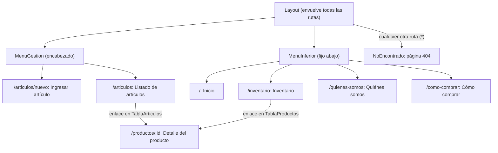
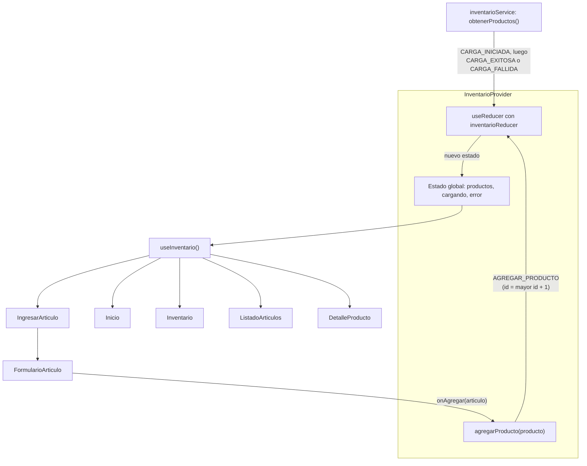

# Supermercado El Ahorro: gestión de inventario

Aplicación web de una sola página (SPA) para gestionar el inventario de un supermercado: muestra los productos, su precio, su stock y cuáles necesitan reposición, y permite ingresar nuevos artículos y consultarlos en un listado.

Actividades formativas 1 y 2, Desarrollo Frontend II (PFY2202), Duoc UC.

## Tecnologías

| Tecnología        | Versión | Uso                                         |
| ----------------- | ------- | ------------------------------------------- |
| React             | 19.3.1  | Interfaz basada en componentes              |
| React Router      | 8.5.0   | Navegación entre páginas (modo declarativo) |
| Vite              | 8.3.4   | Servidor de desarrollo y build              |
| Tailwind CSS      | 4.3.3   | Estilos con clases utilitarias              |
| @tailwindcss/vite | 4.3.3   | Plugin oficial que integra Tailwind en Vite |
| ESLint            | 10.13.0 | Análisis estático del código                |

- Lenguajes: JavaScript (JSX), HTML y CSS con Tailwind CSS v4, sin TypeScript ni librerías de UI.
- Estado global del inventario con Context + useReducer de React, sin librerías externas.
- React Router 8 se instala y se importa como `react-router`; reemplaza al paquete `react-router-dom` de versiones anteriores.

### Diferencias con la guía de aprendizaje

Las guías del ramo usan herramientas que cambiaron desde su publicación. Este proyecto usa sus equivalentes actuales, manteniendo los mismos conceptos:

| En la guía                                                         | En este proyecto                                    | Motivo                                                                                                        |
| ------------------------------------------------------------------ | --------------------------------------------------- | ------------------------------------------------------------------------------------------------------------- |
| Create React App (`npx create-react-app`)                          | Vite                                                | Create React App fue deprecado oficialmente por el equipo de React en febrero de 2025                         |
| React Router v6 con `react-router-dom`                             | React Router 8 con `react-router`                   | Es la versión actual. v8 eliminó el paquete `react-router-dom` y v6 ya no recibe actualizaciones de seguridad |
| `useHistory`                                                       | `useNavigate`                                       | `useHistory` pertenece a React Router v5 y no existe desde v6                                                 |
| Leer el parámetro cortando `useLocation().pathname`                | `useParams`                                         | Forma oficial de leer parámetros de rutas dinámicas como `/productos/:id`                                     |
| `import React from 'react'` para usar JSX                          | Sin ese import                                      | Desde React 17 el JSX no requiere importar React                                                              |
| Tailwind v3 (`npx tailwindcss init`, `tailwind.config.js`, `@tailwind`) | Tailwind v4 con `@tailwindcss/vite` y `@import "tailwindcss"` | Es la versión vigente; v4 se configura desde el CSS y no usa archivo de configuración ni PostCSS      |

Los elementos de React Router que evalúa la actividad (`BrowserRouter`, `Routes`, `Route`, `Link`, `NavLink`, `useNavigate`) se usan igual que en la guía; solo cambia el paquete desde donde se importan (`react-router`). `createContext`, `useContext` y `useReducer` se importan desde `react`, igual que en la guía.

## Funcionalidades

- Página de inicio con bienvenida, resumen del inventario y accesos rápidos a las demás secciones.
- Inventario en tabla con filtro por categoría.
- Resumen con el total de productos, cuántos tienen stock bajo y cuántos están agotados.
- Estado de stock por producto: Disponible, Stock bajo o Agotado, con insignias de color.
- Mensajes de carga mientras se obtienen los productos y mensaje de error si la carga falla.
- Página de detalle de cada producto, con mensaje si el producto no existe.
- Formulario "Ingresar artículo" (nombre, marca, tipo, precio, stock y stock mínimo) con validaciones, mensajes de error por campo y aviso de éxito.
- "Listado de artículos" en tabla, ordenado por nombre, con el total de artículos registrados.
- Páginas informativas: Quiénes somos y Cómo comprar.
- Página 404 para rutas inexistentes.
- Menú de gestión en el encabezado y menú inferior fijo; ambos marcan la página activa.
- Diseño responsive: bajo 640px las tablas se muestran como tarjetas.

## Rutas

| Ruta              | Componente         | Descripción                                          |
| ----------------- | ------------------ | ---------------------------------------------------- |
| `/`               | `Inicio`           | Bienvenida, resumen del inventario y accesos rápidos |
| `/inventario`     | `Inventario`       | Control de stock con resumen y filtro por categoría  |
| `/productos/:id`  | `DetalleProducto`  | Detalle de un producto (ruta dinámica)               |
| `/articulos/nuevo`| `IngresarArticulo` | Formulario para agregar un artículo al inventario    |
| `/articulos`      | `ListadoArticulos` | Catálogo de artículos: nombre, marca, tipo y precio  |
| `/quienes-somos`  | `QuienesSomos`     | Historia, misión, visión y valores                   |
| `/como-comprar`   | `ComoComprar`      | Pasos de compra, medios de pago y despacho           |
| `*`               | `NoEncontrado`     | Cualquier ruta que no existe (404)                   |

Todas las rutas se muestran dentro del componente `Layout`.

## Implementación de la navegación

| Elemento               | Dónde                    | Para qué                                                                                                                                                    |
| ---------------------- | ------------------------ | ----------------------------------------------------------------------------------------------------------------------------------------------------------- |
| `BrowserRouter`        | `src/main.jsx`           | Envuelve a `InventarioProvider` y `App` y habilita el enrutamiento con URLs normales                                                                         |
| `Routes` y `Route`     | `src/App.jsx`            | Definen las rutas de forma declarativa                                                                                                                      |
| Ruta layout + `Outlet` | `App.jsx` y `Layout.jsx` | Una ruta sin `path` con `element={<Layout />}` agrupa a las demás; `Outlet` indica dónde se dibuja la página actual, entre el encabezado y el menú inferior |
| Ruta `index`           | `App.jsx`                | Muestra `Inicio` en `/`                                                                                                                                     |
| `NavLink`              | `MenuInferior.jsx`       | Menú de 4 opciones (Inicio, Inventario, Quiénes somos y Cómo comprar). Agrega `aria-current="page"` al enlace de la página actual; en `/` se usa `end` para que no quede activo en todas las rutas |
| `NavLink`              | `MenuGestion.jsx`        | Menú del encabezado (`aria-label="Menú de gestión"`) con Ingresar artículo y Listado de artículos. `/articulos` usa `end` para no quedar activo en `/articulos/nuevo` |
| `useParams`            | `DetalleProducto.jsx`    | Lee el `:id` de la URL; `buscarProductoPorId` busca ese producto en la lista que entrega `useInventario`                                                    |
| `useNavigate`          | `NoEncontrado.jsx`       | El botón "Volver atrás" ejecuta `navigate(-1)`                                                                                                              |
| `Link`                 | Todas las páginas        | Enlaces internos sin recargar la página                                                                                                                     |

- **Por qué** `Number(id)`**:** `useParams` siempre entrega texto (`"7"`), pero los `id` de los productos son números. `buscarProductoPorId(productos, id)` (en `src/utils/inventario.js`) convierte el valor con `Number()` para que la comparación estricta con `===` funcione.
- **Por qué** `Link` **y no** `<a>`**:** un `<a href>` recarga toda la aplicación y pierde el estado global (incluidos los artículos agregados); `Link` cambia la URL y React solo vuelve a renderizar la página.

## Estructura del proyecto

```
src/
├── components/   Componentes reutilizables: Layout, MenuInferior, MenuGestion, Aviso, EstadoStock, TituloPagina y VolverArriba
│   ├── inventario/   Piezas del inventario: ResumenInventario, FiltroCategoria, TablaProductos y FilaProducto
│   └── articulos/    Piezas de artículos: FormularioArticulo, TablaArticulos y FilaArticulo
├── config/       sitio.js: nombre del supermercado (NOMBRE_SUPERMERCADO)
├── context/      InventarioContext.js (createContext) e InventarioProvider.jsx (estado global y carga inicial)
├── data/         Datos de ejemplo: productos.js (inventario con marca) y empresa.js (textos y valores)
├── hooks/        useInventario.js: lee el contexto del inventario
├── pages/        Una página por ruta, incluidas IngresarArticulo y ListadoArticulos
├── reducers/     inventarioReducer.js: ACCIONES, estadoInicial y el reducer
├── services/     inventarioService.js: obtenerProductos() simula una consulta que tarda 600 ms
├── styles/       clases.js: listas de clases de Tailwind compartidas (tarjetas, superficies y tablas)
├── utils/        Funciones puras: formato.js (precios en CLP), inventario.js (estado de stock, resumen y búsqueda por id) y validacion.js (validarArticulo)
├── App.jsx       Definición de las rutas
├── main.jsx      Punto de entrada: monta la app dentro de BrowserRouter e InventarioProvider
└── index.css     Tailwind, paleta en @theme static y estilos base de elementos
```

## Decisiones técnicas

| Decisión                     | Detalle                                                                                                                                                                                                                                   |
| ---------------------------- | ----------------------------------------------------------------------------------------------------------------------------------------------------------------------------------------------------------------------------------------- |
| Capas de datos               | Las páginas no importan los datos directamente; el recorrido completo está en el diagrama [Flujo de datos](#flujo-de-datos) |
| Estados de carga y error     | `InventarioProvider` despacha `CARGA_INICIADA` y luego `CARGA_EXITOSA` o `CARGA_FALLIDA`, con una variable `activo` para no actualizar el estado si se desmonta. Las páginas muestran `Aviso` mientras cargan y `<Aviso tipo="error">` si falla (`role="status"` o `role="alert"`). Con `SIMULAR_ERROR = true` en el servicio se prueba el error |
| Componentes reutilizables    | `EstadoStock` (insignia de estado), `ResumenInventario` (se usa en Inicio e Inventario), `TablaProductos` y `FilaProducto`, `TablaArticulos` y `FilaArticulo`, `FiltroCategoria`, `Aviso` (tipos info, error y éxito) y `TituloPagina`     |
| Estado levantado en el filtro | `Inventario` guarda la categoría elegida con `useState` y se la pasa a `FiltroCategoria`, que es controlado (`valor` y `onCambiar`) y no tiene estado propio. Las categorías y la lista filtrada se calculan en cada render, sin duplicar estado |
| Funciones puras en `utils`   | `formatearPrecio` usa `Intl.NumberFormat('es-CL')` con CLP; `obtenerEstadoStock` devuelve `{ clave, etiqueta }`; `resumirInventario` cuenta los productos por estado con `reduce`; `buscarProductoPorId` busca por id; `validarArticulo` devuelve los errores por campo. No dependen de React |
| `<title>` por página         | React 19 mueve el `<title>` de cada página al `<head>`, sin librerías extra. `TituloPagina` arma el texto con el nombre de `src/config/sitio.js`. El detalle usa el nombre del producto                                                    |
| Tabla a tarjetas en móvil    | Bajo 640px (`sm`) cada fila se muestra como tarjeta y cada celda muestra su etiqueta con `before:content-[attr(data-label)]`; desde `sm` es una tabla normal. El encabezado usa `sr-only` para que los lectores de pantalla lo sigan leyendo |

## Semana 2: decisiones técnicas

- **Estado global con Context + useReducer en lugar de `useState` por página.** Hay una sola fuente de verdad: los datos se cargan una vez al iniciar la app y todas las páginas leen el mismo estado con `useInventario`. El reducer centraliza las acciones (`CARGA_INICIADA`, `CARGA_EXITOSA`, `CARGA_FALLIDA` y `AGREGAR_PRODUCTO`) y no muta el estado. Los artículos nuevos reciben un id numérico correlativo (mayor id + 1) para que la ruta `/productos/:id` los encuentre.
- **Tailwind CSS v4 con su plugin de Vite en lugar del método de la guía (v3).** Se sigue el mismo criterio de la semana 1: usar herramientas vigentes. La migración desde CSS con BEM fue completa para no mantener dos sistemas de estilos. La paleta está en `@theme static` (genera utilidades como `bg-primario` y mantiene las variables `--color-*`) y los estilos de elementos están en `@layer base`. Las listas de clases largas o repetidas se guardan en constantes; las que comparten varios componentes, en `src/styles/clases.js`.
- **`/inventario` y `/articulos` leen el mismo estado con propósitos distintos.** `/inventario` es el control de stock (estado, resumen y filtro); `/articulos` es el catálogo de artículos registrados con nombre, marca, tipo y precio.
- **El sitio está orientado al personal del supermercado.** Las páginas institucionales (Quiénes somos y Cómo comprar) cumplen los temas de la semana 1. Separar las vistas por roles requiere autenticación y queda fuera del alcance de esta actividad.
- **El estado vive en memoria.** Los artículos agregados se pierden al recargar la página, porque la actividad no incluye persistencia.
- **Volver al inicio al cambiar de página.** El componente `VolverArriba` (en `Layout`) ejecuta `window.scrollTo(0, 0)` cuando cambia la ruta. Se usa un componente propio porque `ScrollRestoration` solo está disponible con un data router (`createBrowserRouter`) y el proyecto usa el modo declarativo con `BrowserRouter`. Las navegaciones `POP` (botones Atrás y Adelante del navegador) se excluyen para que el navegador conserve la posición en la que el usuario estaba.

## Diagramas

### Navegación

Muestra los dos menús del `Layout`, las rutas a las que lleva cada uno, desde dónde se abre el detalle de un producto y la ruta comodín 404.



### Flujo de datos

Muestra cómo se cargan los productos en el estado global, cómo lo leen las páginas y cómo un artículo nuevo del formulario actualiza todas las vistas.



## Cómo ejecutar

Requiere Node.js 22.22 o superior.

```bash
npm install
npm run dev
```

Luego abrir [http://localhost:5173](http://localhost:5173).

| Script            | Qué hace                                                |
| ----------------- | ------------------------------------------------------- |
| `npm run dev`     | Inicia el servidor de desarrollo con recarga automática |
| `npm run build`   | Genera la versión de producción en `dist/`              |
| `npm run preview` | Sirve localmente la versión generada en `dist/`         |
| `npm run lint`    | Revisa el código con ESLint                             |

## Autor

Alonso Basualdo
